<p align="center">
  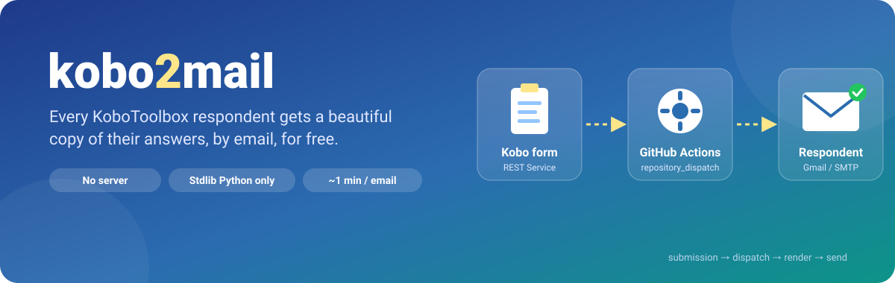
</p>

<p align="center">
  
  
  
  
  
  
</p>

<p align="center">
  <b>Every KoboToolbox respondent receives a well-designed email with a copy of their own answers.</b><br>
  It needs only a Kobo REST Service and GitHub Actions: no server to host and nothing to install.<br><br>
  <a href="#-how-it-works">How it works</a> ·
  <a href="#-email-designs">Designs</a> ·
  <a href="#-quick-start">Quick start</a> ·
  <a href="#%EF%B8%8F-configuration">Configuration</a> ·
  <a href="#-pdf-copy">PDF copy</a> ·
  <a href="#-staying-inside-the-free-tier">Free tier</a> ·
  <a href="#-privacy">Privacy</a>
</p>

---

## ✨ Features

<table>
  <tr>
    <td width="33%" valign="top">
      <h3>📬 Sent to the respondent</h3>
      The recipient address is read <b>from the submission itself</b>, so each person gets their own copy.
    </td>
    <td width="33%" valign="top">
      <h3>🧩 You choose the fields</h3>
      Include or exclude fields with glob patterns, rename questions, and turn choice codes into labels, including select_multiple.
    </td>
    <td width="33%" valign="top">
      <h3>🎨 Five email designs</h3>
      Responsive HTML with a plain-text fallback, your brand color and logo, an optional button, and section and repeat-group cards. Optionally, a <a href="#-pdf-copy">PDF copy</a> is attached.
    </td>
  </tr>
  <tr>
    <td valign="top">
      <h3>💸 Fits the free tier</h3>
      Each email is one short job of about 10–15 s with nothing to install. Submissions with no address are skipped before a runner starts.
    </td>
    <td valign="top">
      <h3>🔒 Privacy first</h3>
      Submission values are never printed. The recipient address is masked in the logs, and errors name fields, not values.
    </td>
    <td valign="top">
      <h3>🐍 Zero dependencies</h3>
      Uses only the Python standard library and the Python preinstalled on the runner. The PDF copy uses the runner's preinstalled Chrome. Works with Gmail or any SMTP server.
    </td>
  </tr>
</table>

---

## 🔁 How it works

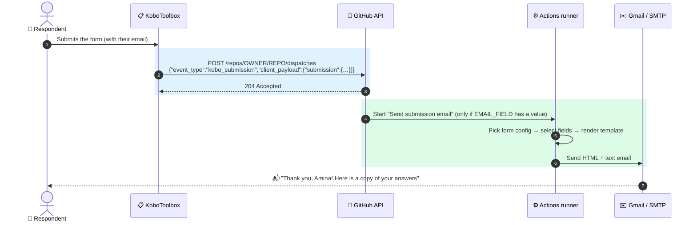

### What happens inside one run

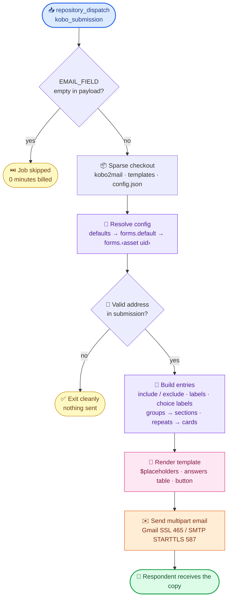

### From raw Kobo JSON to a readable email

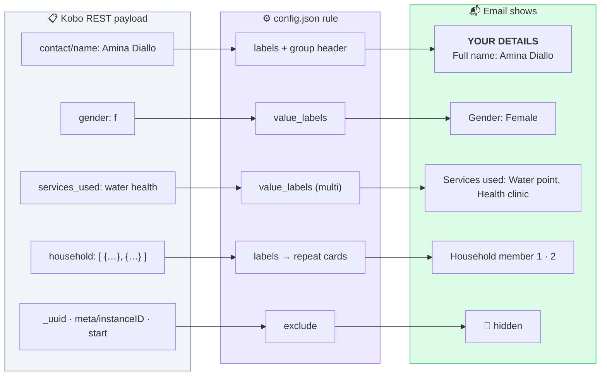

---

## 🎨 Email designs

Five templates are included. Each one follows your `brand_color`, `logo_url` and optional button. To choose one, set `"template"` in `config.json`.

<table>
  <tr>
    <th>✨ Modern <sub><code>templates/modern.html</code></sub></th>
    <th>🧾 Receipt <sub><code>templates/receipt.html</code></sub></th>
    <th>🏳️ Banner <sub><code>templates/banner.html</code></sub></th>
  </tr>
  <tr>
    <td>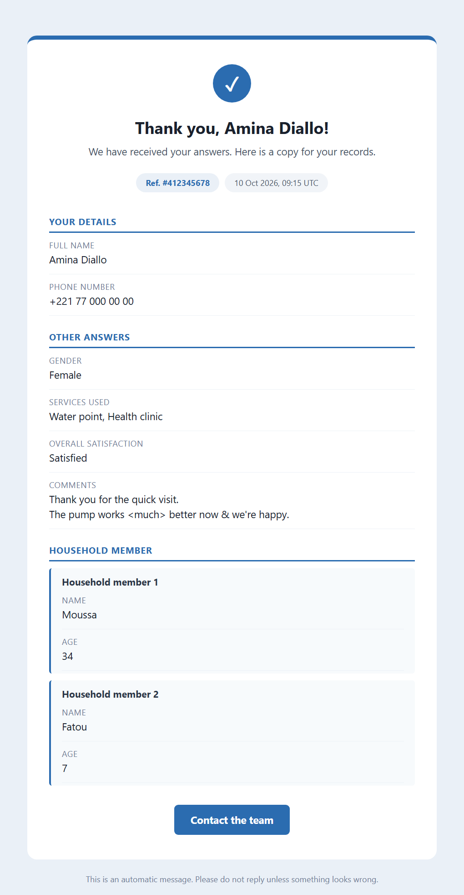</td>
    <td>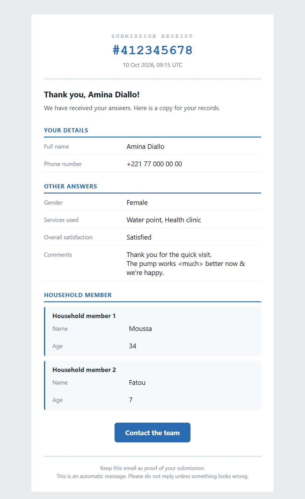</td>
    <td>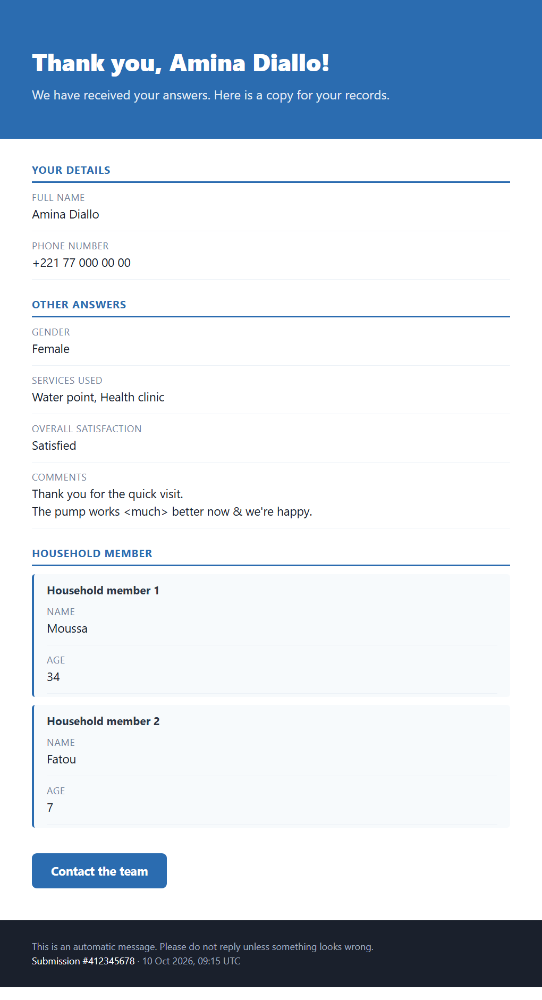</td>
  </tr>
  <tr>
    <td>Tinted background, check-mark badge, reference and date tags</td>
    <td>Proof-of-submission style: big reference number, two-column answers</td>
    <td>Full-width brand header, dark footer band</td>
  </tr>
  <tr>
    <th>📄 Default <sub><code>templates/default.html</code></sub></th>
    <th>🖋️ Minimal <sub><code>templates/minimal.html</code></sub></th>
    <th>📱 On a phone</th>
  </tr>
  <tr>
    <td>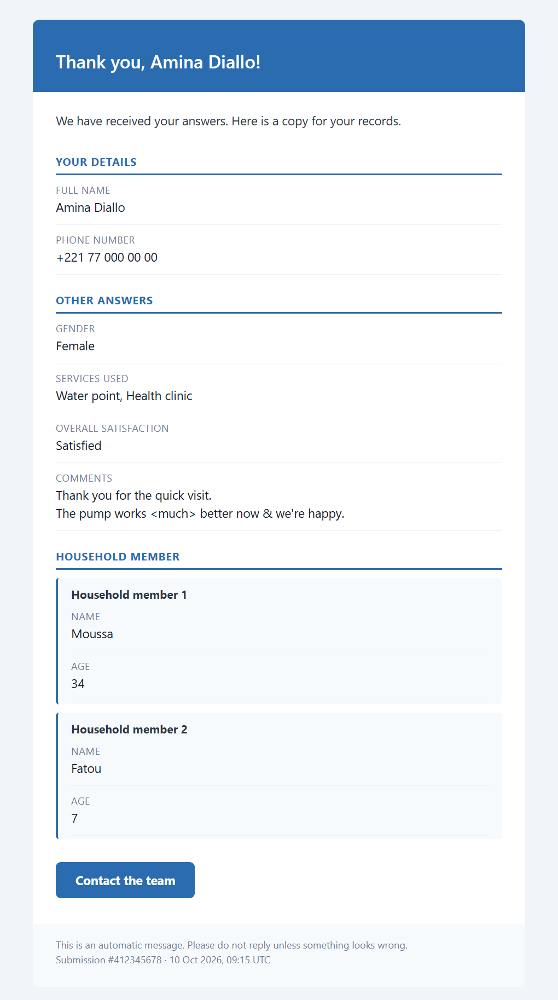</td>
    <td>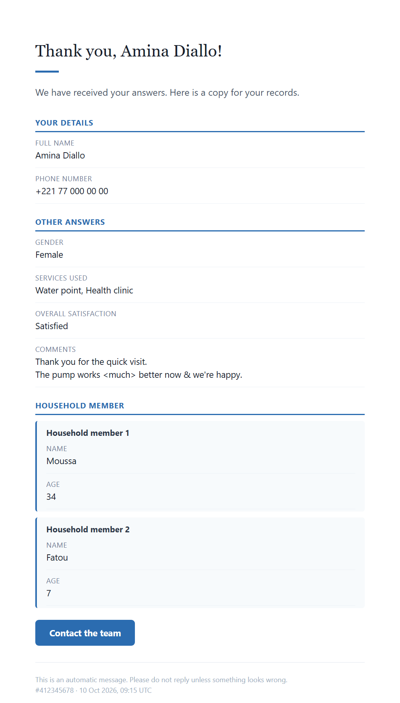</td>
    <td align="center">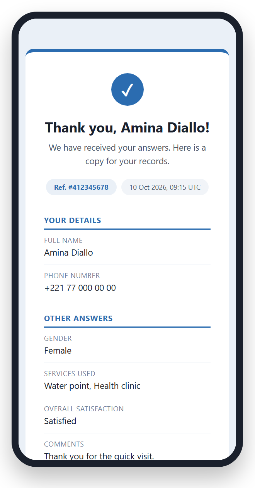</td>
  </tr>
  <tr>
    <td>Classic colored header on a white card</td>
    <td>Letter-like: serif title, short brand rule</td>
    <td>Every design is responsive (shown: Modern)</td>
  </tr>
</table>

> [!TIP]
> To preview every design with **your own** config and a sample submission, at desktop and phone width, run:
> ```bash
> python -m kobo2mail.gallery        # writes gallery.html: open it in your browser
> ```

<details>
<summary><b>🛠️ Make your own design</b></summary>

1. Copy any file in [`templates/`](templates) and point `"template"` at your copy.
2. Use **inline styles and tables**, because email clients ignore most `<style>` blocks and modern CSS.
3. Use the placeholders below anywhere in the template:

| Placeholder | Content |
|---|---|
| `$answers_table` | The rendered answers: sections, fields and repeat cards |
| `$title`, `$intro`, `$footer`, `$subject` | Your config texts, after their placeholders are filled |
| `$brand_color`, `$brand_tint` | Your color, and a pale version of it for backgrounds |
| `$logo_block`, `$button_block` | The `` logo and the call-to-action button (empty if not configured) |
| `$submission_id`, `$submitted_at` | `_id`, and `_submission_time` formatted as `10 Oct 2026, 09:15 UTC` |
| `$name`, `$contact__name`, … | Any submission field, by bare name or by full path with `/` written as `__` |
| `$org_name`, … | Anything you define in `vars` |

- To set the template's default answers layout, add `<!-- kobo2mail: layout=columns -->` (or `stacked`).
- Write `$$` to get a literal `$`.
</details>

---

## 🚀 Quick start

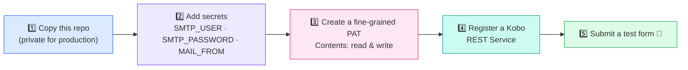

### 1️⃣ Repository
Fork or copy this repo. The workflow in [`.github/workflows/send-email.yml`](.github/workflows/send-email.yml) must be on the default branch.

> [!IMPORTANT]
> **Public for sharing, private for production.** A public repo gets unlimited free minutes, but anyone can read its run history, and that history contains respondents' data. See [Privacy](#-privacy).

### 2️⃣ Secrets and variables
Go to **Settings → Secrets and variables → Actions**.

| Secret | | Notes |
|---|:-:|---|
| `SMTP_USER` | 🔴 required | Gmail address or SMTP login |
| `SMTP_PASSWORD` | 🔴 required | A Gmail [app password](https://myaccount.google.com/apppasswords) (2-step verification required), or your SMTP password |
| `MAIL_FROM` | 🟠 recommended | Sender address. Defaults to `SMTP_USER` |
| `SMTP_HOST` / `SMTP_PORT` | 🔵 smtp only | For example `smtp.office365.com` / `587`. Port 587 uses STARTTLS and 465 uses SSL. |
| `MAIL_REPLY_TO` | ⚪ optional | Where respondents' replies go |
| `MAIL_BCC` | ⚪ optional | Receives a hidden archive copy of every email |

| Variable | Notes |
|---|---|
| `EMAIL_FIELD` | Same path as `email_field` in the config, for example `contact/email`. It turns on the **free skip** for submissions without an address. |
| `MAIL_PROVIDER` | `gmail` or `smtp`. It overrides `provider` in `config.json`. |

### 3️⃣ GitHub token for Kobo
Create a **fine-grained personal access token** with two settings:
- **Repository access:** *only this repository*.
- **Permissions:** **Contents: Read and write**. This is what `repository_dispatch` requires.

### 4️⃣ Kobo REST Service
In Kobo, open your project → **Settings → REST Services → Register a new service**.

| Field | Value |
|---|---|
| Endpoint URL | `https://api.github.com/repos/OWNER/REPO/dispatches` |
| Type | JSON |
| Custom HTTP headers | `Authorization` = `Bearer <your token>`<br>`Accept` = `application/vnd.github+json` |
| Custom wrapper | `{"event_type":"kobo_submission","client_payload":{"submission":%SUBMISSION%}}` |
| Select fields subset | Optional. Fewer fields means smaller payloads and less personal data in GitHub. |

> [!NOTE]
> - **Nest the submission.** It must sit under `submission`, because GitHub accepts at most **10 top-level keys** in `client_payload`.
> - **Status.** Kobo shows **HTTP 204** when GitHub accepted the event.

### 5️⃣ Test it
- **Demo form:** no form yet? Upload [`examples/kobo2mail_demo_form.xlsx`](examples/kobo2mail_demo_form.xlsx) to Kobo and deploy it. Its question names (`contact/name`, `contact/email`, `gender`, `services_used`, `satisfaction`, the `household` repeat…) match the default `config.json`, so set `EMAIL_FIELD` to `contact/email` and it works as is.
- **From Kobo:** submit the form, then watch **Actions → Send submission email**.
- **Without Kobo:** click **Run workflow**. Leave *Submission JSON* empty to use the sample, and untick `dry_run` to really send.

---

## ⚙️ Configuration

`config.json` is committed to the repo and contains **no secrets**. One repo can serve several Kobo forms:

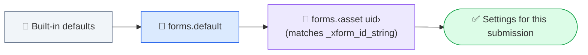

```jsonc
{
  "provider": "gmail",
  "forms": {
    "default": {
      "email_field": "contact/email",                       // the question holding the respondent's address
      "subject": "Thank you $name - copy of your submission",
      "title": "Thank you, $name!",
      "template": "templates/modern.html",
      "brand_color": "#2b6cb0",
      "include": ["*"],
      "exclude": ["_*", "meta/*", "formhub/*", "start", "end", "contact/email"],
      "labels": { "contact": "Your details", "contact/phone": "Phone number" },
      "value_labels": { "gender": { "f": "Female", "m": "Male" } },
      "button_label": "Contact us", "button_url": "mailto:team@example.org"
    },
    "aYourAssetUid": { "brand_color": "#2f855a", "template": "templates/receipt.html" }
  }
}
```

<details>
<summary><b>📚 All configuration keys</b></summary>

| Key | Meaning |
|---|---|
| `email_field` | Path of the question holding the respondent's email. If empty, the first field named `*email` / `*e_mail` that contains an address is used. |
| `subject`, `title`, `intro`, `footer` | Texts that can use `$placeholders` |
| `from_name` | Display name of the sender |
| `template` | HTML template path (default `templates/default.html`) |
| `layout` | `stacked` puts each label above its value (best on mobile). `columns` puts the label in a left column. If empty, the template's default is used. |
| `brand_color`, `logo_url` | Accent color, plus an optional logo (an absolute https URL) |
| `include` / `exclude` | Glob patterns on the full Kobo path, such as `contact/*`, `_*` or `meta/*`. **Exclude always wins.** If a repeat is included, its child fields are included as well. |
| `labels` | Display names by full path (`contact/phone`) or bare name (`phone`). Also used for group and repeat headers. Fields without a label are humanized: `phone_number` becomes "Phone number". |
| `value_labels` | Choice labels such as `{"gender": {"f": "Female"}}`. Space-separated values from select_multiple are split and each one is mapped. |
| `hide_empty` | Hide unanswered questions (default `true`) |
| `group_headers` | Show a section header per Kobo group (default `true`) |
| `ungrouped_label` | Header for questions outside a group that come after a group (default "Other answers") |
| `button_label`, `button_url` | Optional call-to-action button. Placeholders work. Only `https`, `http` and `mailto` links are allowed. |
| `vars` | Your own placeholders, such as `{"org_name": "ACME"}`, used as `$org_name` |
| `pdf` | `true` attaches a PDF copy of the answers (default `false`). See [PDF copy](#-pdf-copy). |
| `pdf_title` | Heading of the PDF (default "Copy of your submission"). Placeholders work. |
| `pdf_filename` | Attachment name (default `submission-$submission_id.pdf`). Placeholders work; unsafe characters become `_`. |
| `pdf_template` | Print template (default `templates/pdf.html`). Real CSS works here, unlike in email templates. |

See [`config.example.json`](config.example.json) for a full example with two forms.
</details>

---

## 📎 PDF copy

Each email can carry a PDF of the same answers: same fields, labels and choice labels, on A4 with a header, reference number and date. It is **off by default**. To turn it on, add `"pdf": true` to `forms.default` (all forms) or to one `forms.‹asset uid›` in `config.json`:

```jsonc
"default": {
  "pdf": true,
  "pdf_title": "Copy of your submission",          // heading of the PDF
  "pdf_filename": "submission-$submission_id.pdf"  // attachment name; placeholders work
}
```

- **No install.** The PDF is printed by headless Chrome, which is already on GitHub's `ubuntu-latest` runners. Locally, kobo2mail finds Chrome, Chromium or Edge, or uses `CHROME_PATH`.
- **Any script.** Accents, Arabic, Cyrillic and other scripts render as they do in a browser.
- **Never blocks the email.** If the PDF cannot be made, the email is still sent without it and the log shows a warning.
- **Cost.** It adds about 2–3 s per run, still well inside the 1 billed minute.

```bash
python -m kobo2mail --submission examples/sample_submission.json --pdf-out copy.pdf   # look at the PDF
```

---

## 💸 Staying inside the free tier

GitHub bills each job **rounded up to the next minute**, so the goal is *one short job per email*, and **zero** jobs when there is nothing to send.

| | Measure | Effect |
|:-:|---|---|
| ⚡ | Single job, no `setup-python`, no `pip install` | About 10–15 s, which bills as **1 minute** |
| 📦 | Shallow, sparse checkout | Only the code, templates and config are fetched (about 2 s) |
| ⏭️ | Job-level `if:` on `vars.EMAIL_FIELD` | No address means the job is **skipped**, and skipped jobs cost **0 minutes** |
| ⏱️ | `timeout-minutes: 2` | A stuck SMTP server cannot burn minutes |
| 🧹 | No artifacts, caches or concurrency queue | Nothing extra to store or wait for |

| Repo visibility | Free minutes | Approximate emails per month |
|---|---|---|
| 🔒 Private | 2,000 per month | **about 2,000** |
| 🌍 Public | unlimited | unlimited (but see [Privacy](#-privacy)) |

---

## 🧪 Local testing

```bash
python -m unittest discover -s tests -v                                                   # offline tests
python -m kobo2mail --submission examples/sample_submission.json --preview preview.html   # open in a browser
python -m kobo2mail --submission examples/sample_submission.json --pdf-out copy.pdf        # PDF copy (needs Chrome or Edge)
python -m kobo2mail --submission examples/sample_submission.json --dry-run               # print, don't send
python -m kobo2mail --submission examples/sample_submission.json --template templates/receipt.html --preview preview.html
```

To send a real email:
1. Put your own address in a copy of the sample file.
2. Set `SMTP_USER`, `SMTP_PASSWORD` and `MAIL_FROM` in your environment.
3. Run the command without `--dry-run`.

---

## 🔒 Privacy

> [!WARNING]
> GitHub stores the dispatch payload, which is the submission, with every run. In a **public** repo, anyone can read it. Use a public repo to share the code, and **run production from a private repo**. Delete old runs if your data policy requires it.

- 🙈 **Logs.** The script never prints submission values. Only the manual `--dry-run` prints the email.
- 🎭 **Address.** The recipient address is masked with `::add-mask::`.
- 🏷️ **Errors.** Errors name fields, never values. SMTP errors show only the error type.
- ✂️ **Kobo field subset.** Choosing only the fields you need in the REST Service limits what reaches GitHub.

## ⚠️ Limits

- **Attachments.** Apart from the optional [PDF copy](#-pdf-copy), photos and files are not attached, because their Kobo URLs require authentication.
- **Gmail quota.** Gmail allows about **500 recipients a day**. Use an SMTP relay for more.
- **Failed runs.** HTTP 204 only means GitHub accepted the event. If sending fails later, the run fails and Kobo does **not** retry. Turn on GitHub's failure notifications.
- **Email clients.** Outlook for Windows ignores some CSS, so rounded corners and badges appear square there.

## 🗂️ Project layout

```
kobo2mail/
├── .github/workflows/send-email.yml   # repository_dispatch → one short job
├── kobo2mail/
│   ├── __main__.py   # CLI: --event / --submission / --dry-run / --preview / --template
│   ├── config.py     # defaults → forms.default → forms.<asset uid>
│   ├── fields.py     # recipient lookup, include/exclude, labels, repeats
│   ├── render.py     # placeholders, answers table, HTML + text
│   ├── mailer.py     # Gmail / SMTP sending
│   ├── pdf.py        # PDF copy via headless Chrome
│   └── gallery.py    # side-by-side preview of every template
├── templates/        # default · modern · minimal · receipt · banner · pdf (print)
├── examples/         # sample_submission.json · kobo2mail_demo_form.xlsx (XLSForm)
├── tests/            # offline unit tests (python -m unittest)
└── config.json       # your settings (no secrets)
```

---

<p align="center">
  Based on the same idea as <a href="https://github.com/JamesLeonDufour/kobo-choice-sync">kobo-choice-sync</a>: Kobo REST Services + GitHub Actions, with no server.<br>
  <sub>MIT License</sub>
</p>
